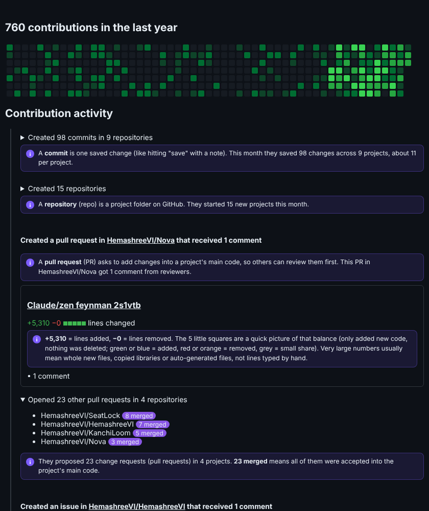
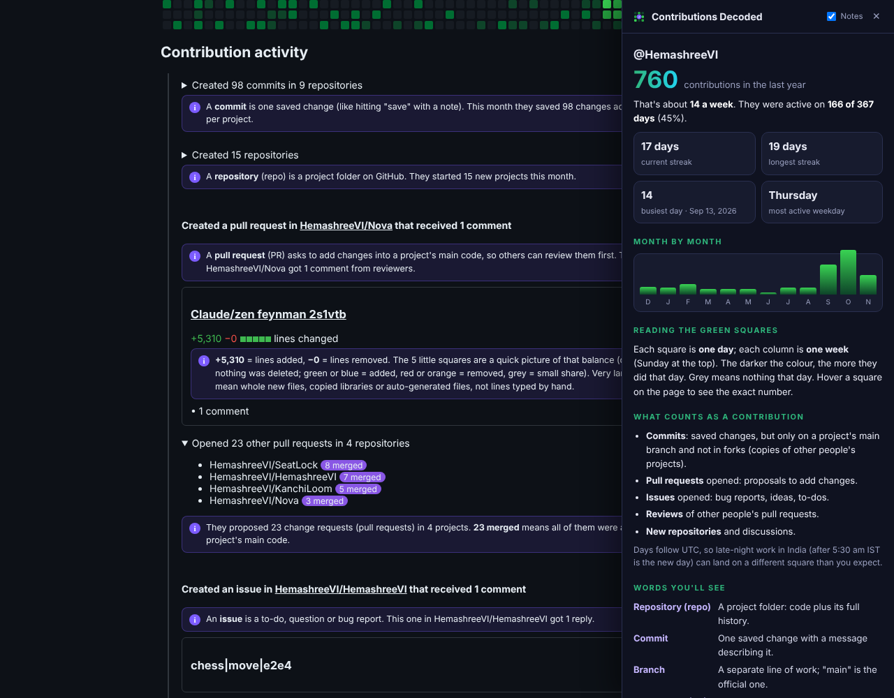

# ❓ Contributions Decoded

**GitHub profiles, explained in plain English.** What do the green squares mean? What's "+5,310 −0" and those 5 little boxes? What's "8 merged"? This extension writes the answer right under each line, on **any** GitHub profile, yours or anyone else's.

<p align="center"> </p>

<p align="center"><a href="https://github.com/HemashreeVI/contributions-decoded/releases/latest"></a></p>

> **Install in 1 minute:** download the `.zip` from the [latest release](https://github.com/HemashreeVI/contributions-decoded/releases/latest) → unzip it → open `chrome://extensions` → turn on **Developer mode** → **Load unpacked** → pick the unzipped folder.

## What you get

**Notes under the activity feed**, for example:
- *Created 98 commits in 9 repositories* → "A **commit** is one saved change… about 11 per project."
- *+5,310 −0 ■■■■■* → "lines added / lines removed; the 5 squares show the balance… very large numbers usually mean whole new files or generated code."
- *Opened 23 pull requests… 8 merged* → "23 change requests; all of them were accepted into the project's main code."

**An "Explain" panel** (the tab on the right edge):
- the yearly total in human terms (*about 14 a week, active on 166 of 367 days*)
- current and longest streak, busiest day, most active weekday
- a month-by-month chart
- how to read the green squares, what counts as a contribution (and what doesn't, like forks), and why days follow UTC
- a mini glossary: repo, commit, branch, pull request, merged, fork, star…

Switch the notes off and on with the **Notes** toggle.

## How it works

It reads only what's already on the profile page (the calendar's day cells and the activity text) and matches the phrases GitHub uses. **No API calls, no rate limits, no data leaves the page.** If GitHub changes a phrase it doesn't recognise, that line is simply left alone.

## Install (2 minutes)

1. Download this repo: **Code → Download ZIP**, then unzip it (or `git clone` it).
2. Open `chrome://extensions` in Chrome (or Edge / Brave).
3. Turn on **Developer mode** (top right).
4. Click **Load unpacked** and choose the unzipped folder (the one with `manifest.json`).
5. Pin it from the 🧩 puzzle-piece menu so it is one click away.

Then open any GitHub profile, e.g. `github.com/torvalds`.

## Tests

`tests/test.js` loads the extension into headless Chromium with [Playwright](https://playwright.dev), opens realistic mock pages and checks the results end to end (screenshots go to the folder you pass in):

```bash
npm i -D playwright && npx playwright install chromium
node tests/test.js /tmp
```
